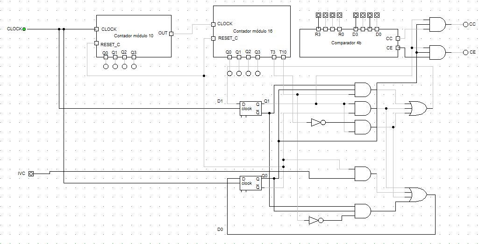
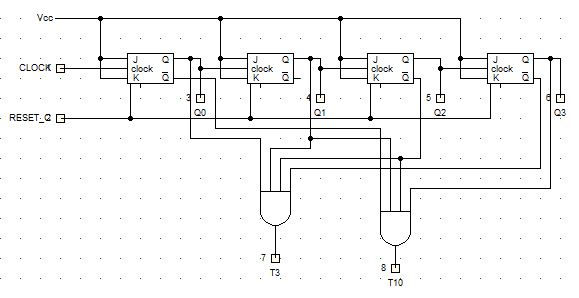
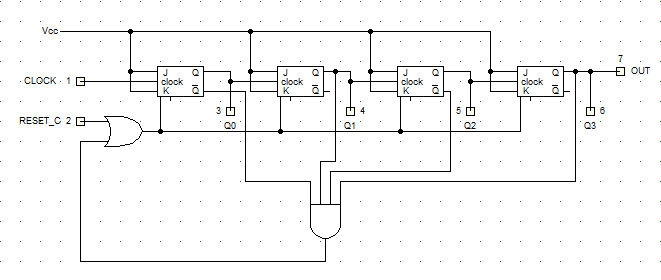
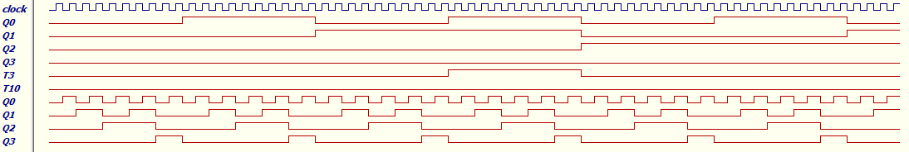
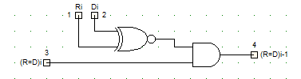
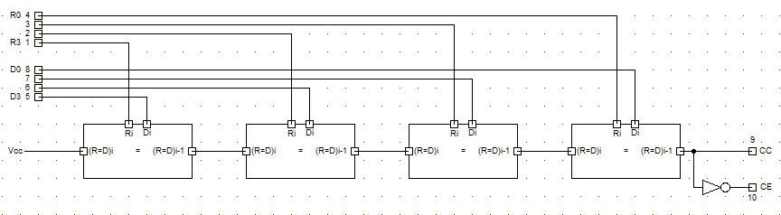
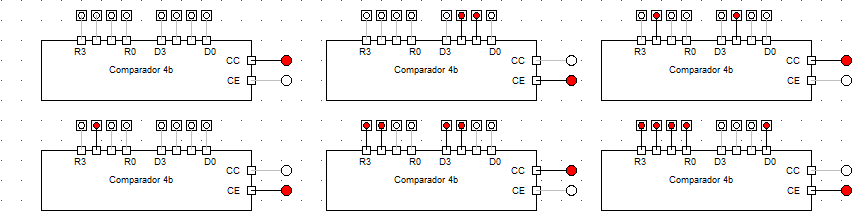
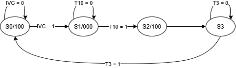
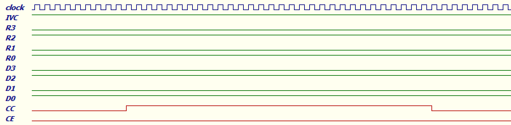
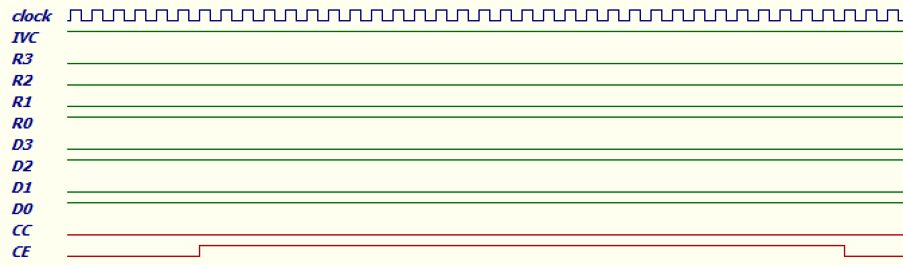

[English](README.md) | [Português](README.pt.md) | **Deutsch**

# Digitales Zugangskontrollsystem

Ein digitales System zur Prüfung eines Zugangscodes, entwickelt in Digital Works für die Lehrveranstaltung **Computerarchitektur** im Bachelorstudiengang Informatik (Engenharia Informática) an der Universidade Aberta, Portugal (2026/27).

Der Benutzer fordert Zugang an, hat 10 Sekunden Zeit, einen 4-Bit-Code einzugeben, und das System zeigt anschließend 3 Sekunden lang an, ob der Code richtig oder falsch ist. Intern besteht das System aus drei Modulen: einem zählerbasierten **Zeitgeber**, einem 4-Bit-**Komparator** und einem **synchronen endlichen Zustandsautomaten**, der die beiden anderen Module steuert.



> Mit Erlaubnis des Dozenten als Portfolio-Projekt veröffentlicht.
## Inhalt des Repositorys

| Datei | Inhalt |
|---|---|
| `circuits/A_counter.dwm` | Zeitgeber: Frequenzteiler und 4-Bit-Zähler |
| `circuits/B_comparator.dwm` | 4-Bit-Gleichheitskomparator |
| `circuits/C_state_machine.dwm` | Gesamtsystem mit Zustandsautomat |
| `images/` | Schaltungen und Impulsdiagramme aus dieser README |
| `report/report_pt.pdf` | Vollständiger Projektbericht (auf Portugiesisch) |

Die Schaltungen lassen sich in Digital Works (Windows) öffnen. Die Makros sind in jeder Datei eingebettet, sodass jede Schaltung eigenständig funktioniert: Datei öffnen, Simulation starten und die Eingänge betätigen.

Die Signalnamen stammen aus der (portugiesischen) Aufgabenstellung: CC steht für *código correto* (richtiger Code), CE für *código errado* (falscher Code) und IVC für *iniciar a validação do código* (Codeprüfung starten).

## Systemarchitektur

```
                ┌──────────────┐  GLEICH  ┌────────────────────┐
R3:R0, D3:D0 ──►│  Komparator  ├─────────►│                    ├──► CC
                └──────────────┘          │                    ├──► CE
IVC ─────────────────────────────────────►│  Zustandsautomat   │
                                          │    (synchron)      │
                ┌──────────────┐  T10, T3 │                    │
                │  Zeitgeber   ├─────────►│                    │
                │ (Teiler ÷10  │◄─────────┤                    │
                │  + Zähler)   │ RESET_C  └────────────────────┘
                └──────────────┘

CLOCK (10 Hz) ──► Zeitgeber und Zustandsautomat
```

| Signal | Art | Beschreibung |
|---|---|---|
| CLOCK | Eingang | Systemtakt, 10 Hz |
| IVC | Eingang | Zugangsanforderung (Codeprüfung starten) |
| R3:R0 | Eingänge | Vom Benutzer eingegebener Code |
| D3:D0 | Eingänge | Richtiger Code, vom Administrator festgelegt |
| CC / CE | Ausgänge | LEDs für richtigen / falschen Code |
| T10, T3, GLEICH, RESET_C | Intern | Verbindungen zwischen den Modulen |

## A. Zeitgeber

Das System misst Intervalle von 10 s und 3 s auf Basis eines 10-Hz-Takts. Dazu verwendet es zwei **asynchrone Zähler** (Ripple-Zähler) aus JK-Flipflops im Toggle-Betrieb (J = K = 1):

- **Frequenzteiler (Modulo 10):** zählt die Taktimpulse von 0 bis 9. Erreicht er 10 (1010), erkennt ein UND-Gatter diesen Zustand und setzt den Zähler über die *Clear*-Eingänge zurück. Ein ODER-Gatter verknüpft diese Erkennung mit dem Signal RESET_C. Der Ausgang des Teilers hat alle 10 Taktimpulse eine Flanke, also **1 Hz**.
- **Hauptzähler (Modulo 16):** zählt einmal pro Sekunde von 0 bis 15 weiter und erzeugt zwei decodierte Ausgänge:
  - T3 = Q̄₃·Q̄₂·Q₁·Q₀ (Zustand 3, Ende der 3 s)
  - T10 = Q₃·Q̄₂·Q₁·Q̄₀ (Zustand 10, Ende der 10 s)

| Modulo-16-Zähler | Modulo-10-Teiler |
|---|---|
|  |  |

Im folgenden Impulsdiagramm wechselt der Hauptzähler (oben) einmal pro vollständigem Zyklus des Teilers (unten) den Zustand, und T3 ist während des gesamten Zustands 3 aktiv:



**Warum asynchrone Zähler?** Sie benötigen keine kombinatorische Logik an den Flipflop-Eingängen, wodurch die Schaltung einfacher wird. Ihre typischen Übergangszustände (zum Beispiel das kurzzeitige Durchlaufen von 1010 zwischen 11 und 12) beeinträchtigen das System nicht: Sie sind wesentlich kürzer als die Taktperiode (0,1 s), und T3 und T10 werden vom synchronen Zustandsautomaten nur an den Taktflanken ausgewertet.

## B. 4-Bit-Komparator

Der Komparator ist ein **iterativer Komparator**: vier gleiche Zellen, vom höchstwertigen zum niedrigstwertigen Bit hintereinandergeschaltet. Jede Zelle erhält die Information „bisher ist alles gleich“ und gibt sie nur weiter, wenn auch das aktuelle Bit gleich ist:

(R=D)ᵢ₋₁ = (R=D)ᵢ · (Rᵢ ⊕ Dᵢ)'

Jede Zelle besteht aus einem **XNOR**-Gatter und einem nachgeschalteten **UND**-Gatter. Der Eingang der ersten Zelle liegt auf Vcc (1), da vor dem Vergleich des ersten Bits noch kein Unterschied besteht. Der Ausgang der letzten Zelle ist CC, und CE wird über einen Inverter gebildet.

| 1-Bit-Zelle | 4-Bit-Komparator |
|---|---|
|  |  |

Der Komparator wurde mit gleichen Codes und mit Codes getestet, die sich in verschiedenen Bits unterscheiden:



## C. Zustandsautomat

### Zustandsdiagramm



Ausgänge in der Reihenfolge (RESET_C, CC, CE). In S₃: RESET_C = 0, CC = GLEICH, CE = GLEICH'.

| Zustand | Kodierung Q₁Q₀ | Funktion | Übergangsbedingung |
|---|---|---|---|
| S₀ | 00 | Ruhezustand: Zähler auf 0 gehalten, wartet auf IVC | IVC = 1 |
| S₁ | 01 | Prüfung: der Zähler zählt die 10 s | T10 = 1 |
| S₂ | 10 | Zurücksetzen des Zählers (dauert einen Taktzyklus) | unbedingt |
| S₃ | 11 | Ergebnis: zeigt CC oder CE 3 s lang an | T3 = 1 |

Es handelt sich um einen **gemischten** Automaten: In S₀, S₁ und S₂ hängen die Ausgänge nur vom Zustand ab (Moore), in S₃ hängen CC und CE zusätzlich vom Signal GLEICH des Komparators ab (Mealy). Dies ist die direkteste Umsetzung des geforderten Verhaltens und kommt mit nur 4 Zuständen aus.

### Gleichungen

Bei 4 Zuständen genügen 2 D-Flipflops. Es wurde die natürliche Binärkodierung verwendet, und die Gleichungen wurden aus der Zustandsübergangstabelle abgeleitet und mit boolescher Algebra vereinfacht:

| Funktion | Gleichung |
|---|---|
| D₁ | Q̄₁·Q₀·T10 + Q₁·Q̄₀ + Q₁·T̄3 |
| D₀ | Q₁·Q̄₀ + Q̄₀·IVC + Q₁·T̄3 + Q̄₁·Q₀·T̄10 |
| RESET_C | Q̄₀ |
| CC | Q₁·Q₀·GLEICH |
| CE | Q₁·Q₀·GLEICH' |

Einige Implementierungsentscheidungen:

- **RESET_C = Q̄₀** kommt direkt von einem Flipflop, ohne zwischengeschaltete Gatter. Dadurch kann kein Dekodier-Glitch die Zähler, deren Reset asynchron wirkt, fälschlicherweise zurücksetzen.
- Die Terme **Q₁·Q̄₀** und **Q₁·T̄3** kommen sowohl in D₁ als auch in D₀ vor und werden daher jeweils von einem einzigen UND-Gatter erzeugt.
- **GLEICH'** wird direkt vom Ausgang CE des Komparators abgenommen, wodurch ein Inverter entfällt.
- Die gesamte Logik des Zustandsautomaten besteht aus **2 Invertern, 7 UND-Gattern und 2 ODER-Gattern**.

### Tests

Richtiger Code (R3:R0 = D3:D0 = 0101): Die LED CC leuchtet 30 Taktzyklen lang, also 3 s.



Falscher Code (R3:R0 = 0001, D3:D0 = 0101): Stattdessen leuchtet die LED CE 3 s lang.



### Bekannte Einschränkungen

- Da CC und CE in S₃ vom Komparator abhängen, folgen die LEDs einer Änderung des Codes während der 3-sekündigen Anzeige. Alternativ könnte das Ergebnis am Ende der Prüfung in einem Flipflop gespeichert werden, wodurch der Automat vollständig zum Moore-Automaten würde.
- Bleibt IVC auf 1, startet der Automat sofort nach der Rückkehr in den Ruhezustand eine neue Prüfung. Für eine einzelne Anforderung sollte der Benutzer IVC wieder auf 0 setzen.

## Literatur

Arroz, G., Monteiro, J., & Oliveira, A. (2024). *Arquitectura de Computadores: dos Sistemas Digitais aos Microprocessadores*. IST Press.
