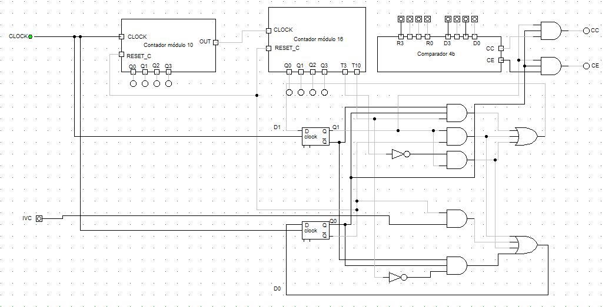
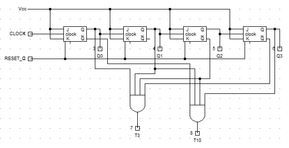
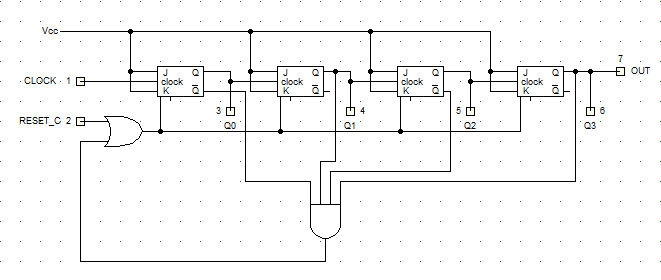
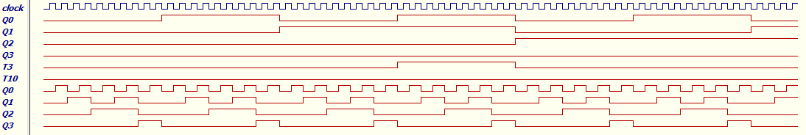
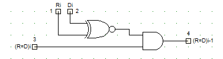
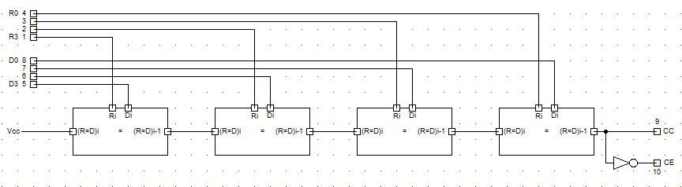
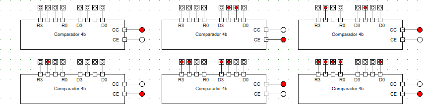
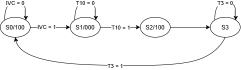
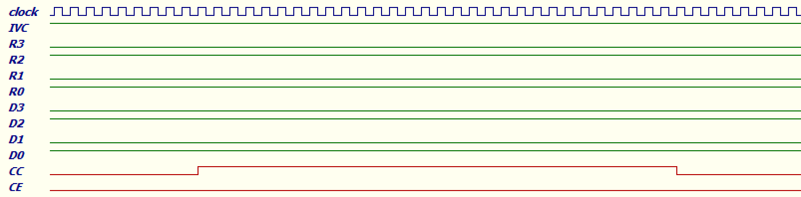
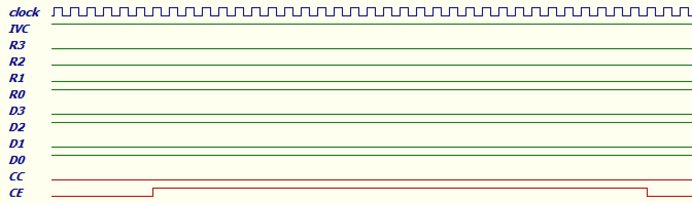

**English** | [Português](README.pt.md) | [Deutsch](README.de.md)

# Digital access control system

A digital access-code validation system designed in Digital Works for the **Computer Architecture** course of the BSc in Computer Engineering at Universidade Aberta, Portugal (2026/27).

The user requests access, has 10 seconds to enter a 4-bit code, and the system then shows for 3 seconds whether the code is correct or wrong. Under the hood, the system is built from three modules: a counter-based **timer**, a 4-bit **comparator**, and a **synchronous finite state machine** that coordinates the other two.



> Shared with the lecturer's permission, as a portfolio project.

## Repository contents

| File | Contents |
|---|---|
| `circuits/A_counter.dwm` | Timer: frequency divider and 4-bit counter |
| `circuits/B_comparator.dwm` | 4-bit equality comparator |
| `circuits/C_state_machine.dwm` | Full system, including the state machine |
| `images/` | Circuits and timing diagrams used in this README |
| `report/report_pt.pdf` | Full project report (in Portuguese) |

The circuits open in Digital Works (Windows). The macros are embedded in each file, so every circuit runs on its own: open it, start the simulation and use the inputs.

Signal names follow the original (Portuguese) assignment brief: CC stands for *código correto* (correct code), CE for *código errado* (wrong code) and IVC for *iniciar a validação do código* (start code validation).

## System architecture

```
                ┌──────────────┐  EQUAL   ┌────────────────────┐
R3:R0, D3:D0 ──►│  Comparator  ├─────────►│                    ├──► CC
                └──────────────┘          │                    ├──► CE
IVC ─────────────────────────────────────►│   State machine    │
                                          │   (synchronous)    │
                ┌──────────────┐  T10, T3 │                    │
                │    Timer     ├─────────►│                    │
                │ (÷10 divider │◄─────────┤                    │
                │  + counter)  │ RESET_C  └────────────────────┘
                └──────────────┘

CLOCK (10 Hz) ──► timer and state machine
```

| Signal | Type | Description |
|---|---|---|
| CLOCK | Input | System clock, 10 Hz |
| IVC | Input | Access request (start code validation) |
| R3:R0 | Inputs | Code entered by the user |
| D3:D0 | Inputs | Correct code, set by the administrator |
| CC / CE | Outputs | Correct code / wrong code LEDs |
| T10, T3, EQUAL, RESET_C | Internal | Connections between modules |

## A. Timer

The system measures 10 s and 3 s intervals from a 10 Hz clock. It uses two **asynchronous counters**, built from JK flip-flops in toggle mode (J = K = 1):

- **Frequency divider (mod 10):** counts clock pulses from 0 to 9. When it reaches 10 (1010), an AND gate detects that state and resets the counter through the *Clear* inputs. An OR gate combines this detection with the RESET_C signal. The divider output has one edge every 10 clock pulses, i.e. **1 Hz**.
- **Main counter (mod 16):** advances once per second, from 0 to 15, and produces two decoded outputs:
  - T3 = Q̄₃·Q̄₂·Q₁·Q₀ (state 3, end of the 3 s)
  - T10 = Q₃·Q̄₂·Q₁·Q̄₀ (state 10, end of the 10 s)

| Mod-16 counter | Mod-10 divider |
|---|---|
|  |  |

In the timing diagram below, the main counter (top) changes state once per full divider cycle (bottom), and T3 stays active throughout state 3:



**Why asynchronous counters?** They need no combinational logic on the flip-flop inputs, which keeps the circuit simpler. Their typical transient states (for example, briefly passing through 1010 between 11 and 12) do not affect the system: they last far less than the clock period (0.1 s), and T3 and T10 are only read by the synchronous state machine on clock edges.

## B. 4-bit comparator

The comparator is an **iterative comparator**: four identical cells chained from the most significant bit to the least significant bit. Each cell receives the "everything is equal so far" signal and only passes it on if the current bit is also equal:

(R=D)ᵢ₋₁ = (R=D)ᵢ · (Rᵢ ⊕ Dᵢ)'

Each cell is an **XNOR** gate followed by an **AND** gate. The first cell's input is tied to Vcc (1), since no differences exist before any bit is compared. The last cell's output is CC, and CE comes from an inverter.

| 1-bit cell | 4-bit comparator |
|---|---|
|  |  |

The comparator was tested with equal codes and with codes that differ in different bits:



## C. State machine

### State diagram



Outputs in the order (RESET_C, CC, CE). In S₃: RESET_C = 0, CC = EQUAL, CE = EQUAL'.

| State | Code Q₁Q₀ | Function | Condition to advance |
|---|---|---|---|
| S₀ | 00 | Idle: counter held at 0, waiting for IVC | IVC = 1 |
| S₁ | 01 | Validation: the counter counts the 10 s | T10 = 1 |
| S₂ | 10 | Counter reset (lasts one clock cycle) | unconditional |
| S₃ | 11 | Result: shows CC or CE for 3 s | T3 = 1 |

This is a **mixed** machine: in S₀, S₁ and S₂ the outputs depend only on the state (Moore), while in S₃ CC and CE also depend on the comparator's EQUAL signal (Mealy). It is the most direct reading of the required behaviour, with only 4 states.

### Equations

With 4 states, 2 D flip-flops are enough. Natural binary encoding was used, and the equations were derived from the state transition table and simplified with Boolean algebra:

| Function | Equation |
|---|---|
| D₁ | Q̄₁·Q₀·T10 + Q₁·Q̄₀ + Q₁·T̄3 |
| D₀ | Q₁·Q̄₀ + Q̄₀·IVC + Q₁·T̄3 + Q̄₁·Q₀·T̄10 |
| RESET_C | Q̄₀ |
| CC | Q₁·Q₀·EQUAL |
| CE | Q₁·Q₀·EQUAL' |

Some implementation decisions:

- **RESET_C = Q̄₀** comes straight from a flip-flop, with no gates in between. This way, no decoding glitch can wrongly reset the counters, whose reset is asynchronous.
- The terms **Q₁·Q̄₀** and **Q₁·T̄3** are shared by D₁ and D₀, so each one is produced by a single AND gate.
- **EQUAL'** is taken directly from the comparator's CE output, which saves an inverter.
- The whole state machine logic uses **2 inverters, 7 AND gates and 2 OR gates**.

### Tests

Correct code (R3:R0 = D3:D0 = 0101): the CC LED stays on for 30 clock cycles, i.e. 3 s.



Wrong code (R3:R0 = 0001, D3:D0 = 0101): the CE LED stays on for 3 s instead.



### Known limitations

- Since CC and CE depend on the comparator in S₃, if the user changes the code during the 3 s display, the LEDs follow the change. An alternative would be to store the result in a flip-flop at the end of validation, which would make the machine fully Moore.
- If IVC is left at 1, the machine starts a new validation as soon as it returns to idle. For a single request, the user should set IVC back to 0.

## References

Arroz, G., Monteiro, J., & Oliveira, A. (2024). *Arquitectura de Computadores: dos Sistemas Digitais aos Microprocessadores*. IST Press.
