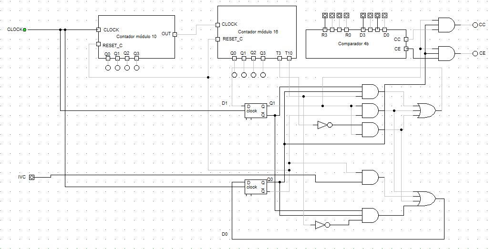
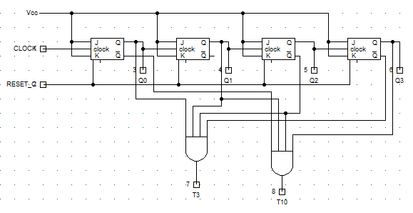
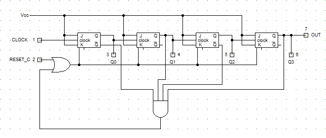
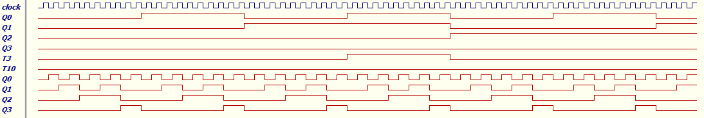
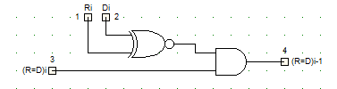
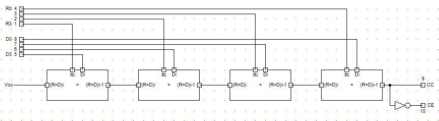
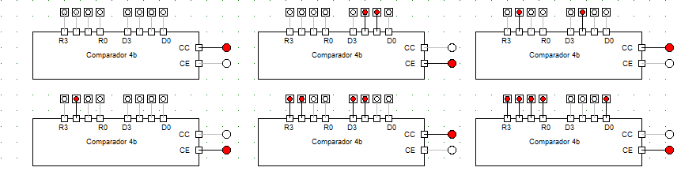
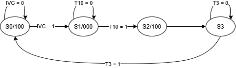
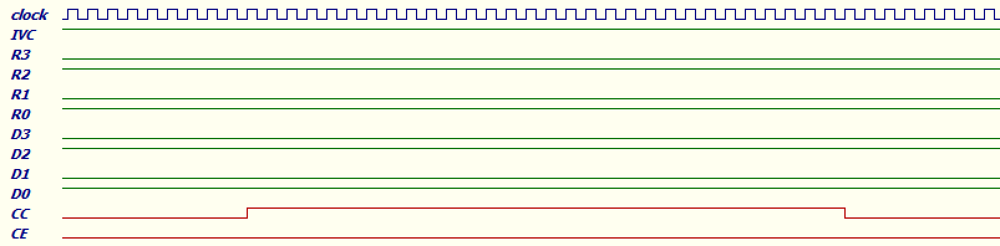
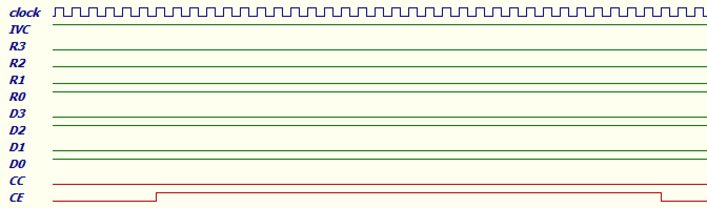

[English](README.md) | **Português** | [Deutsch](README.de.md)

# Sistema digital de controlo de acessos

Projeto de um sistema digital de validação de código de acesso, desenvolvido no Digital Works para a unidade curricular de **Arquitetura de Computadores** da Licenciatura em Engenharia Informática da Universidade Aberta (2026/27).

O utilizador pede acesso, tem 10 segundos para introduzir um código de 4 bits e o sistema mostra durante 3 segundos se o código está certo ou errado. Por baixo, o sistema é composto por três módulos: um **temporizador** baseado em contadores, um **comparador** de 4 bits e uma **máquina de estados finitos síncrona** que coordena os outros dois.



> Projeto partilhado com autorização do docente, para fins de portefólio.

## Estrutura do repositório

| Ficheiro | Conteúdo |
|---|---|
| `circuits/A_counter.dwm` | Temporizador: divisor de frequência e contador de 4 bits |
| `circuits/B_comparator.dwm` | Comparador de igualdade de 4 bits |
| `circuits/C_state_machine.dwm` | Sistema completo, com a máquina de estados |
| `images/` | Circuitos e historiais lógicos usados neste README |
| `report/report_pt.pdf` | Relatório completo do projeto |

Os circuitos abrem no Digital Works (Windows). As macros estão incluídas dentro de cada ficheiro, por isso cada circuito funciona sozinho: basta abrir, iniciar a simulação e atuar nas entradas.

## Arquitetura do sistema

```
                ┌──────────────┐  IGUAL   ┌────────────────────┐
R3:R0, D3:D0 ──►│  Comparador  ├─────────►│                    ├──► CC
                └──────────────┘          │                    ├──► CE
IVC ─────────────────────────────────────►│ Máquina de estados │
                                          │     (síncrona)     │
                ┌──────────────┐  T10, T3 │                    │
                │ Temporizador ├─────────►│                    │
                │ (divisor ÷10 │◄─────────┤                    │
                │ + contador)  │ RESET_C  └────────────────────┘
                └──────────────┘

CLOCK (10 Hz) ──► temporizador e máquina de estados
```

| Sinal | Tipo | Descrição |
|---|---|---|
| CLOCK | Entrada | Relógio do sistema, a 10 Hz |
| IVC | Entrada | Pedido de acesso (iniciar a validação do código) |
| R3:R0 | Entradas | Código introduzido pelo utilizador |
| D3:D0 | Entradas | Código correto, definido pelo administrador |
| CC / CE | Saídas | LEDs de código correto / código errado |
| T10, T3, IGUAL, RESET_C | Internos | Ligações entre os módulos |

## A. Temporizador

O sistema mede intervalos de 10 s e de 3 s a partir de um relógio de 10 Hz. Para isso usa dois **contadores assíncronos**, construídos com básculas JK em modo de comutação (J = K = 1):

- **Divisor de frequência (módulo 10):** conta os impulsos do relógio de 0 a 9. Ao atingir 10 (1010), uma porta AND deteta o estado e reinicia o contador através das entradas *Clear*. Uma porta OR junta esta deteção ao sinal RESET_C. A saída do divisor tem um flanco por cada 10 impulsos de relógio, ou seja, **1 Hz**.
- **Contador principal (módulo 16):** avança uma vez por segundo, de 0 a 15, e gera duas saídas descodificadas:
  - T3 = Q̄₃·Q̄₂·Q₁·Q₀ (estado 3, fim dos 3 s)
  - T10 = Q₃·Q̄₂·Q₁·Q̄₀ (estado 10, fim dos 10 s)

| Contador módulo 16 | Divisor módulo 10 |
|---|---|
|  |  |

No historial abaixo, o contador principal (em cima) muda de estado uma vez por cada ciclo completo do divisor (em baixo), e T3 fica ativo durante todo o estado 3:



**Porquê contadores assíncronos?** Dispensam a lógica combinatória nas entradas das básculas e resultam num circuito mais simples. Os estados transitórios típicos destes contadores (por exemplo, a passagem momentânea por 1010 entre 11 e 12) não afetam o sistema: duram muito menos do que o período do relógio (0,1 s), e T3 e T10 só são lidos pela máquina de estados síncrona nos flancos do relógio.

## B. Comparador de 4 bits

O comparador é um **comparador iterativo**: quatro células iguais, encadeadas do bit mais significativo para o menos significativo. Cada célula recebe a indicação "até aqui é tudo igual" e só a mantém se o bit atual também for igual:

(R=D)ᵢ₋₁ = (R=D)ᵢ · (Rᵢ ⊕ Dᵢ)'

Cada célula é uma porta **XNOR** seguida de uma **AND**. A entrada da primeira célula está ligada a Vcc (1), porque antes de comparar qualquer bit ainda não há diferenças. A saída da última célula é o CC, e o CE é obtido com um inversor.

| Célula de 1 bit | Comparador de 4 bits |
|---|---|
|  |  |

O comparador foi testado com códigos iguais e com códigos que diferem em bits diferentes:



## C. Máquina de estados

### Diagrama de estados



Saídas na ordem (RESET_C, CC, CE). Em S₃: RESET_C = 0, CC = IGUAL, CE = IGUAL'.

| Estado | Código Q₁Q₀ | Função | Condição para avançar |
|---|---|---|---|
| S₀ | 00 | Repouso: contador parado em 0, à espera do IVC | IVC = 1 |
| S₁ | 01 | Validação: o contador conta os 10 s | T10 = 1 |
| S₂ | 10 | Reinício do contador (dura um ciclo de relógio) | incondicional |
| S₃ | 11 | Resultado: mostra CC ou CE durante 3 s | T3 = 1 |

A máquina é **mista**: em S₀, S₁ e S₂ as saídas dependem só do estado (Moore), e em S₃ o CC e o CE dependem também do sinal IGUAL do comparador (Mealy). É a leitura mais direta do comportamento pedido, com apenas 4 estados.

### Equações

Com 4 estados, bastam 2 básculas D. Usou-se a codificação binária natural, e as equações foram obtidas da tabela de transição e simplificadas algebricamente:

| Função | Equação |
|---|---|
| D₁ | Q̄₁·Q₀·T10 + Q₁·Q̄₀ + Q₁·T̄3 |
| D₀ | Q₁·Q̄₀ + Q̄₀·IVC + Q₁·T̄3 + Q̄₁·Q₀·T̄10 |
| RESET_C | Q̄₀ |
| CC | Q₁·Q₀·IGUAL |
| CE | Q₁·Q₀·IGUAL' |

Algumas decisões de implementação:

- **RESET_C = Q̄₀** vem diretamente de uma báscula, sem portas intermédias. Assim, nenhum *glitch* de descodificação pode reiniciar indevidamente os contadores, cujo reset é assíncrono.
- Os termos **Q₁·Q̄₀** e **Q₁·T̄3** são comuns a D₁ e D₀, por isso cada um é gerado por uma única porta AND.
- **IGUAL'** é obtido diretamente da saída CE do comparador, o que dispensa um inversor.
- Toda a lógica da máquina usa **2 inversores, 7 portas AND e 2 portas OR**.

### Testes

Código correto (R3:R0 = D3:D0 = 0101): o LED CC fica aceso durante 30 ciclos de relógio, ou seja, 3 s.



Código errado (R3:R0 = 0001, D3:D0 = 0101): é o LED CE que fica aceso durante 3 s.



### Limitações conhecidas

- Como o CC e o CE dependem do comparador em S₃, se o utilizador mudar o código durante os 3 s de apresentação, os LEDs acompanham a mudança. Uma alternativa seria guardar o resultado numa báscula no fim da validação, o que tornaria a máquina totalmente de Moore.
- Se o IVC ficar a 1, a máquina inicia uma nova validação logo que regressa ao repouso. Para um único pedido, o utilizador deve repor o IVC a 0.

## Bibliografia

Arroz, G., Monteiro, J., & Oliveira, A. (2024). *Arquitectura de Computadores: dos Sistemas Digitais aos Microprocessadores*. IST Press.
